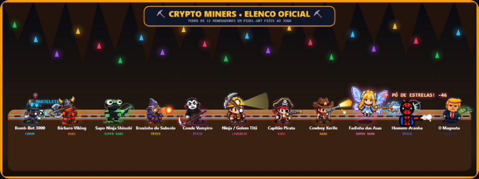

# 🧟 CryptoZombies — Web3 Survival Strategy Game



> **CryptoZombies** é um jogo Web3 de sobrevivência e estratégia contra hordas de zumbis, com estética pixel art retrô. Desenvolvido em **React 19**, **Vite** e **Canvas**, o jogo implementa mapas individuais por jogador, economia dinâmica sustentável baseada em **Minercoin (MNC)**, sistema de sobreviventes, abrigos médicos, Baús do Boss e simulador completo de ROI.

---

## 🌟 Principais Funcionalidades

### 1. 🗺️ Mapas e sobrevivência
- **Mapas individuais**: Cada jogador possui seu próprio mapa associado à conta.
- **Sobrevivência contra zumbis**: A experiência de jogo é centrada no combate e na sobrevivência contra hordas de zumbis.
- **Sem sistema de jazidas**: As antigas mecânicas de jazidas de recursos não fazem mais parte da versão atual do jogo.

### 2. 💰 Economia Oficial da Minercoin (MNC)
- **Cotação Oficial do Projeto**: **1 MNC = US$ 0,01** (100 MNC = US$ 1,00).
- **Cotação Dinâmica**: Ajustável pelo administrador no painel administrativo, refletindo imediatamente em todo o jogo (preço de baús, recompensas, projeções de ROI e saques).
- **Recompensas Justas**: Produção em MNC baseada nos atributos dos heróis (Power, Speed, Stamina) e multiplicadores de casa.

### 3. ⚔️ Sistema de Heróis Mineradores
- **Limite de Mineração**: Até **15 heróis ativos** minerando simultaneamente por mapa.
- **Raridades e Multiplicadores**:
  - ⚪ **Comum** (1×)
  - 🔵 **Raro** (1,5×)
  - 🟣 **Épico** (2×)
  - 🟡 **Lendário** (3×)
- **Revezamento Automático**: Heróis sem energia descansam automaticamente e dão lugar aos heróis recuperados da reserva.

### 4. 📦 Sistema de Baús do Boss & Fragmentos
- **Sorteio por Boss**: O sorteio de Baú do Boss é realizado ao término de cada batalha contra o Boss.
- **Elegibilidade**: Participam do sorteio os sobreviventes registrados na equipe no início da batalha, conforme as regras de participação do Boss. Sobreviventes que entram como substitutos durante o evento não participam daquele sorteio.
- **Chances fixas por raridade**: Comum **2%**; Raro **2,2%**; Super Raro **2,3%**; Épico **2,4%**; Lendário **2,6667%**; Super Lendário **3%**, por sobrevivente elegível. Não há multiplicadores: cada raridade utiliza diretamente sua chance definida.
- **Teto de probabilidade**: A chance total por jogador é limitada a **40% por Boss**.
- **Limite diário de Baús do Boss**: Máximo de **3 por dia** por jogador, com renovação à meia-noite (horário de Brasília - America/Sao_Paulo).
- **Poções**: O sorteio de poções usa diretamente as mesmas chances fixas por raridade: Comum **2%**; Raro **2,2%**; Super Raro **2,3%**; Épico **2,4%**; Lendário **2,6667%**; Super Lendário **3%**, por sobrevivente elegível, sem multiplicadores. A chance total por jogador também tem teto de **40% por Boss**. Limite de **4 poções por dia** por jogador, com renovação à meia-noite de Brasília.
- **Recompensas**: O Baú do Boss contempla Fragmentos de Construção e a possibilidade de obter um Baú de Herói. A distribuição e as quantidades dos fragmentos, poções e a chance específica de Baú de Herói ainda precisam ser consolidadas na regra específica.

### 5. 🏡 Casas de Repouso
- Aceleração da recuperação de energia dos heróis.
- Evolução por níveis utilizando Fragmentos de Construção e MNC.
- Níveis: *Tiny House*, *Basic House*, *Comfort House*, *Mansion*, *Villa*, *Palace*.

### 6. 📊 Menu Estatísticas & Simulador de ROI (3 Cenários)
- **5 Abas de Análise Detalhada**:
  1. **Visão Geral**: Métricas consolidadas da conta.
  2. **Desempenho**: Detalhamento herói por herói.
  3. **Simulador de Upgrades**: Simulação do impacto de melhorias de casas e heróis.
  4. **Simulador de ROI (Baús & Casas)**: Projeções completas em **3 Cenários**:
     - 🔴 **Conservador** (Mínimo garantido)
     - 🟡 **Esperado** (Média ponderada)
     - 🟢 **Otimista** (Teto estatístico)
     - Comparativo lado a lado e projeções de retorno acumulado (30d, 60d, 90d, 180d).
  5. **ROI Real da Conta**: Histórico real de investimento vs retorno monetário.

### 7. 💳 Perfil, Carteira Web3 & Saques com Taxa Regressiva
- Conexão de carteira (MetaMask / Web3).
- Saques de MNC convertidos com base na cotação oficial em USD.
- **Tabela Regressiva de Taxas de Saque**:
  - **15%**: Menos de 50% do investimento recuperado.
  - **10%**: Entre 50% e 100% do investimento recuperado.
  - **5%**: Mais de 100% do investimento recuperado (pós-breakeven).

### 8. 🛠️ Painel Administrativo
- Configuração de probabilidades de drop de Baús do Boss e taxa-base.
- Cotação em tempo real de 1 MNC em USDT.
- Gestão de anúncios premiados (Rewarded Ads).
- Ajustes de parâmetros da economia e mineração.

---

## 🚀 Instalação e Execução

### Pré-requisitos
- [Node.js](https://nodejs.org/) versão 18 ou superior
- [npm](https://www.npmjs.com/) ou [pnpm](https://pnpm.io/)

### Passo a Passo

```bash
# 1. Clonar o repositório
git clone https://github.com/SEU_USUARIO/cripto-myners.git

# 2. Entrar na pasta do projeto
cd cripto-myners

# 3. Instalar as dependências
npm install

# 4. Iniciar o servidor de desenvolvimento
npm run dev
```

Acesse a aplicação no navegador em: `http://localhost:5173/` (ou na porta informada pelo terminal).

---

## 🧪 Testes Automatizados

O projeto conta com suíte de testes unitários para verificação de regras econômicas, escalabilidade e mecânica de mapas:

```bash
npm test
```

### Cobertura dos Testes:
- ✅ Cotação oficial `1 MNC = US$ 0,01` e cálculos de breakeven.
- ✅ Escala de taxas de saque regressivas (15%, 10%, 5%).
- ✅ Mapas individuais e isolamento entre jogadores.
- ✅ Suporte a 1.000 jogadores simultâneos gerando mapas em menos de 600ms.

---

## 🛠️ Tecnologias Utilizadas

- **Frontend**: [React 19](https://react.dev/), [Vite](https://vitejs.dev/)
- **Estilização**: [Tailwind CSS v4](https://tailwindcss.com/)
- **Ícones**: [Lucide React](https://lucide.dev/)
- **Efeitos**: [Canvas Confetti](https://www.npmjs.com/package/canvas-confetti)
- **Engine Gráfica**: HTML5 Canvas 2D & Spritesheets customizados

---

## 📄 Licença

Este projeto é desenvolvido para a plataforma **CryptoZombies**. Todos os direitos reservados.
